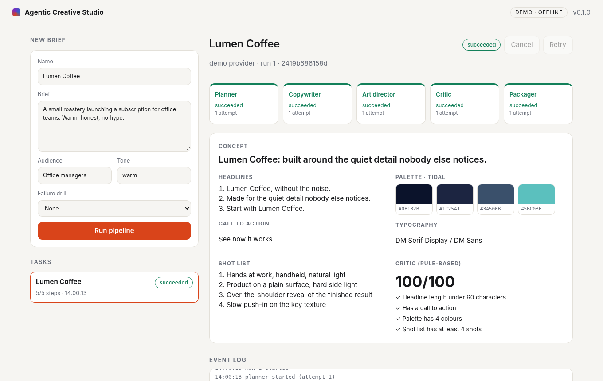

# Agentic Creative Studio

A small multi-agent orchestrator for creative work. You write a brief; five agents (planner, copywriter, art director, critic, packager) turn it into a campaign package: concept, headlines, palette, typography, shot list and a rule-based critique.

It is a demonstration of agent orchestration and a polished front end, not a product. The scope is deliberately narrow so every behaviour is tested.



## What it does

- **Pipeline of five agents** with explicit state per task and per step (`queued`, `running`, `succeeded`, `failed`, `cancelled`).
- **Retries** with exponential back-off for transient errors; permanent errors fail fast.
- **Cancellation** at any point, including during a back-off wait.
- **Manual retry** re-runs only the steps that did not succeed; finished steps are kept.
- **Live updates** over Server-Sent Events, with a per-task event log.
- **Demo mode** that is deterministic and needs no network, API key or dependency.
- **Optional LLM mode** through the Anthropic Messages API, configured only by environment variables on the server.
- **Failure drills** (flaky tool, permanent failure) so the retry and recovery paths can be seen and tested.
- Persistence to a JSON file; tasks interrupted by a restart are marked failed and can be retried.

## What is demonstrated, and against what

| Behaviour | Demo mode (default, no key, no network) | Real model |
| --- | --- | --- |
| Five-agent pipeline, state machine, events | Exercised end to end; screenshots are from real runs | Not run against the live API |
| Retries, permanent failure, cancellation, manual retry, restart recovery | Exercised via failure drills and 36 automated tests | Same orchestrator code path; error mapping unit-tested with mocked HTTP errors |
| Output quality (copy, palette, critique) | Template-based and rule-based: it shows the plumbing, not model quality | **Not verified** |
| LLM request shape, JSON extraction, HTTP error classification | n/a | Unit-tested with an injected transport only |

You can run, test and screenshot everything without paying for an API: demo mode is the default.

## Install

Requires Python 3.10 or later. There are no third-party dependencies.

```bash
git clone <this repository> && cd agentic-creative-studio
python3 --version
```

## Run

```bash
python3 -m acs.server                 # demo mode on http://127.0.0.1:8780
python3 -m acs.server --port 9000     # another port
```

Open the printed address. Submit the default brief, then try the "Failure drill" options:

| Drill | What you will see |
| --- | --- |
| None | Five steps succeed. |
| Flaky tool | The art director fails twice, is retried automatically, and succeeds on attempt 3. |
| Permanent failure | The critic fails; the task stops as `failed`. Press **Retry**: the first three steps are kept and it completes. |

`ACS_DEMO_DELAY` (seconds, default `0.7`) sets the simulated latency of the demo provider so the running state is visible.

### Optional: real model

```bash
cp .env.example .env                  # optional; the server reads real environment variables only
export ACS_LLM_API_KEY=...            # never committed, never sent to the browser
export ACS_LLM_MODEL=claude-sonnet-5-5   # optional; this is the default
python3 -m acs.server --mode llm
```

The key is read from the server environment only. See [docs/SECURITY.md](docs/SECURITY.md) for what is and is not covered. The LLM path is unit-tested with an injected transport; it has not been exercised against the live API in this repository's test suite.

## Tests

```bash
python3 -m unittest discover -s tests -t .
```

36 tests cover the state machine (retries, exhaustion, permanent errors, cancellation during work and during back-off, queued cancellation, manual retry, restart recovery), the providers (determinism, request shape, JSON extraction, HTTP error mapping) and the HTTP API (validation, body limit, cross-origin refusal, path traversal, SSE).

Screenshots in `screenshots/` are produced by a real run: `./scripts/capture_screenshots.sh` (needs the `agent-browser` CLI).

## API

| Method | Path | Purpose |
| --- | --- | --- |
| GET | `/api/health` | Provider, version, retry limit |
| GET | `/api/tasks` | Task list |
| POST | `/api/tasks` | `{"brief": {"title","text","audience","tone"}, "chaos": "none"\|"flaky"\|"broken"}` |
| GET | `/api/tasks/<id>` | Full task with steps and events |
| GET | `/api/tasks/<id>/events` | SSE stream |
| POST | `/api/tasks/<id>/cancel` | Cancel a queued or running task |
| POST | `/api/tasks/<id>/retry` | Retry a failed or cancelled task |

## Documentation

- [Architecture](docs/ARCHITECTURE.md)
- [Security report and limitations](docs/SECURITY.md)
- [Deployment](docs/DEPLOY.md)
- [Case study](docs/CASE_STUDY.md)

## AI assistance

This project was designed and built with AI assistance (Claude Code) and reviewed by its author. The demo agents are template-based; they are not generated by a model unless you enable LLM mode.

## Licence

MIT, see [LICENSE](LICENSE).
