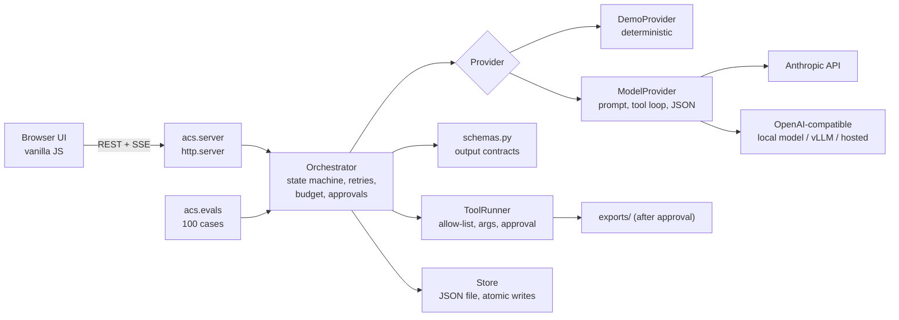

# Architecture

## Modules

| Module | Responsibility |
| --- | --- |
| `acs/agents.py` | Provider interface `run(agent, brief, context, tools=None, feedback=None) -> dict`; `DemoProvider`, `ModelProvider` (shared tool loop), `LLMProvider` (Anthropic), `OpenAICompatProvider`; error types |
| `acs/schemas.py` | Output contract per agent |
| `acs/tools.py` | Tools, parameter specs, per-agent allow-lists, approval for writes |
| `acs/evals/` | Case generator, runner (scripted and live), report |
| `acs/orchestrator.py` | Task and step state machine, retry policy, cancellation, event log, persistence |
| `acs/server.py` | HTTP API, SSE, static files, request validation, security headers |
| `web/` | Single-page UI built with DOM APIs (`textContent`, no `innerHTML`) |

## Pipeline

`planner -> copywriter -> art_director -> critic -> packager`. Each agent receives the brief and the outputs of the steps that already succeeded, and returns one JSON object. Steps run sequentially because each depends on the previous output. Up to two tasks run concurrently (worker pool).

## State machine

Task: `queued -> running -> [awaiting_approval ->] succeeded | failed | cancelled`. Step: `pending -> running -> succeeded | failed | cancelled`.

- **Transient error**: retried up to `max_attempts` (default 3) with back-off `backoff * 2^(attempt-1)`, multiplied by a seeded jitter factor in [0.5, 1.5).
- **Invalid output** (fails `schemas.py` or is not JSON): retried while attempts remain; the next prompt carries the validator's message.
- **Token budget**: after each attempt, prompt + completion tokens of the task are compared with `Policy.budget_tokens`; overspending fails the task.
- **Approval**: if the brief asks for an export, the task stops in `awaiting_approval` with the exact `save_package` call; `/approve` runs it, `/reject` and cancel do not. The wait is a `threading.Event.wait`, so cancellation interrupts it immediately.
- **Permanent error / unexpected exception**: the step and task fail. Exception text is replaced by the exception class name so provider internals do not reach the UI.
- **Retry** (manual): resets steps that did not succeed and queues the task again. Outputs of finished steps are reused as context.
- **Cancel**: sets a per-task flag checked before each step and during back-off. A provider call already in flight is not interrupted; the task stops before the next step.
- **Restart**: on load, tasks that were `queued` or `running` become `failed` with an explanatory message, and can be retried.

## Failure drills

`chaos` is part of the task, applies to the demo provider only, and is deterministic: `flaky` makes the art director fail on attempts 1 and 2 of run 1; `broken` makes the critic fail permanently on run 1 only. This makes recovery behaviour reproducible in tests and in the UI.

## Persistence

`Store` keeps all tasks in memory and writes a JSON file with write-to-temp + `os.replace` (atomic on POSIX). It keeps the latest 200 tasks. This is intentionally simple; see limitations in SECURITY.md.

## Design decisions

- **Standard library only**: the project runs anywhere Python runs and has nothing to audit or update.
- **SSE instead of WebSockets**: one-way updates are all the UI needs, and SSE works through plain `http.server`.
- **Server-side keys**: the browser never sees credentials; the UI cannot select a model or enter a key.
